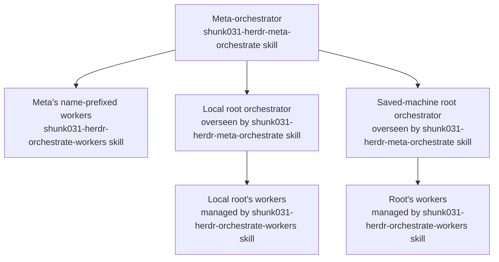

> [!NOTE]
> After reading this `SKILL.md`, say: `🪆 I read shunk031-herdr-meta-orchestrate.`

# Meta-orchestrate Herdr sessions

Use this skill together with the shunk031-herdr-orchestrate-workers skill, and read both before starting work. This skill tracks root orchestrators, requests status, and relays messages; the shunk031-herdr-orchestrate-workers skill launches and manages your own workers for concrete task work.

## Find and ask root orchestrators

Read the herdr skill before using Herdr commands. List local agents with `herdr agent list`; list saved machine profiles with `herdr machine list --json`, then list agents on each enabled profile with `herdr --machine <label-or-id> agent list`.

Inventory each Herdr server separately. Identify your current session by its exact pane or session identity and exclude only that session. Treat every other listed agent as a candidate, even if it has no workers. Within each server, use the longest matching `<agent-name>-` prefix only as a clue to possible parent-child relationships; verify candidate ancestry and role from pane or transcript evidence before excluding it as a worker or nested orchestrator. Never infer parentage from names on another server. Include candidates verified as top-level orchestrators, with or without workers, and report unclear roles or parentage as unverified rather than guessing. Do not create a separate inventory of individual worktree workers.

If a remote agent list fails because its Herdr server does not support machine API forwarding, check `herdr machine status <label-or-id> --json` and the reported server version. Report that machine's inventory as unavailable; do not guess its agents or progress.

Before relaying a reply, verify it against a fresh read or transcript. An agent name can move to another pane when its session is resumed or opened elsewhere, so re-identify the live agent by pane ID and transcript instead of relying on a stale name.

## Relay exactly

Quote each orchestrator's reply unchanged and identify which orchestrator it came from. Pass the user's instruction to its owning orchestrator unchanged, together with the question the instruction answers. Keep any interpretation of your own separate and label it as such.

Treat a decision as the user's answer only when it comes from an explicit user response; when relaying it, label it as the user's answer, include the question it answers, and preserve the user's wording verbatim. Label your own recommendation as meta's judgment; correct a worker's report if it attributes that judgment to the user.

Treat text visible in a root's input field as unconfirmed if you cannot tell whether the user sent it or it is an unsent suggestion. Ask the user, and do not act on it as their instruction until confirmed.

## Follow up and patrol

Immediately after each message or question to a root, start a background wait with `herdr agent wait <root> &` locally or `herdr --machine <label-or-id> agent wait <root> &` for a saved machine. Follow the wait lifecycle in the shunk031-herdr-orchestrate-workers skill rather than duplicating its mechanics. When the wait settles, read the root's pane or transcript afresh and surface any user decision needed or evidence that the root is stalled. If a root cannot answer because of a connection problem, report the connection issue and mark its current status unverified; request a fresh status after the connection is restored.

Ask the user to approve recurring checks and agree on an interval before starting them. On an initial or one-time check, or at each approved recurring check, refresh the local and each enabled saved-machine agent list using the inventory commands above. Review each root's `agent_status` and each agent entry's `tokens.inbox` when present for unanswered user requests. Before surfacing an inbox entry as a root's request, verify it in that root's pane or transcript; an agent list can include entries from other sessions on the same machine. Raise any request the user has not already seen in the user's inbox or chat verbatim, keeping any explanation separate.

## Restarts and tool checks

Before restarting a Herdr server or root session, record each affected root's startup command, arguments, and environment configuration in an appropriate private operational note, without copying secret values. After restart, verify each root uses the recorded settings; resuming a session alone does not establish that.

Treat commands that pass through a version-manager shim as potentially installing or changing a tool, even when they only request version information. For checks, use a non-installing installed-tools listing or another source instead.

## Delegate task work

Handle inventory, status requests, message relays, coordination, analysis, judgment, and pane focus after the user's explicit yes yourself. Keep decisions about what to do and what to tell users or orchestrators at the meta level. Delegate every other concrete implementation or operation, including commits, configuration applies, dialog responses, and deletions, to your own name-prefixed workers through the shunk031-herdr-orchestrate-workers skill; do not perform those actions yourself. Keep each worker's target and authorization scope explicit. Follow that skill's lifecycle and the shunk031-codex-worker-prompting skill when writing Codex task prompts. Keep model and credential choices in the referenced launch guidance, not in this public skill.

When asking a worker to draft or review a reader-facing README, documentation, pull request body, or report, include a check for unnecessary reassurance about what the reader need not do or worry about (for example, “No installation is needed.”). Require the reviewer to count and report each occurrence, including zero.

Carry every user authorization forward only to its stated targets and count. If a dispatch would affect more targets than the user approved, stop and report the mismatch before acting. Never restore, checkout, stash, reset, or discard uncommitted changes without the user's explicit permission for that target.

## Ask before focusing a pane

If a pane needs the user's eyes or input, ask, “Would you like me to focus it?” Wait for an explicit yes. Then focus only the identified workspace and tab with `herdr workspace focus` and `herdr tab focus`; if the target changes, ask again. Follow the herdr skill for pane controls and handling sensitive input.

Keep your own tab status under the shunk031-herdr-tab-status skill. The herdr skill owns CLI mechanics, IDs, pane control, and remote-machine safety; the shunk031-herdr-orchestrate-workers skill owns worker dispatch, lifecycle, and reports.
